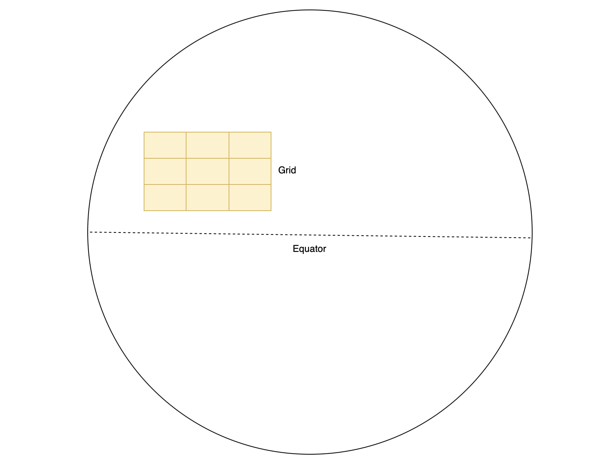
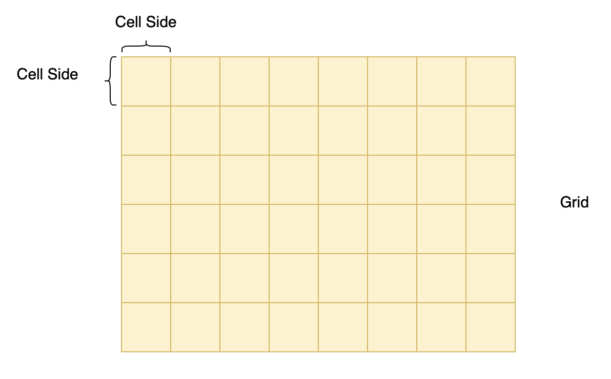

# WebPaLMTo
A web-based application for generating synthetic spatical trajectories using probabilistic language models powered by PaLMTo[^1].  

## Table of Content
- [Overview](#overview)
- [Features](#features)
- [Prerequisites](#prerequisites)
- [Installation](#installation)
- [Initialization](#initialization)
- [Usage]
- [API Documentation]
- [Development]
- [Troubleshooting]
- [Limitations](#limitations)
- [Credits & Reference]

## Overview
A spatial trajectory is a trace generated by a moving object within a certain spatial-temporal context and is generally represented by a series of chronologically ordered points. While trajectory data plays an important role in domains like traffic analysis, public transportation management and wildlife monitoring, accurate and complete data are usually hard to obtain due to various factors, such as weak GPS signal in certain area or low sampling rate as well as privacy concerns. 

**PaLMTo** uses simple probabilistic language models in order to complete missing parts of a trajectory. In [^2] the authors presented an approach, based on PaLMTo for generating arbitrarily large and realistic trajectories based on a given trajectory dataset. This project presents WebPaLMTo, a web-based stand-alone web-based implementation application of the approach presented in [^2].

The main idea behind the trajectory generation is:

- **Tessellate** the trajectory space into grid cells,

- **Assign** unique identifiers to each partition on the tesselated space,

- **Substitute** each trajectory point within a partition by the partition's identifier.

Once that is done, the trajectories will no longer be a set of finely granulated observations, e.g., GPS points, but rather be a sentence in the space of grid identifiers. That allows to learn a probabilistic model, as simple as N-grams, that can be used for various NLP-like tasks, such as sentence completion, but for trajectories.

### How it works
The trajectory generation process involves two main steps:

1. **Build N-gram Model**: the system processes input trajectory data, creates an overlay over the geographical region from which trajectories are sampled from, converts trajecotries into token sequence, and builds probabilistic N-gram models (bigrams and trigrams);

2. **Generate Trajectory**: using the generated N-gram models, the system creates new synthetic trajectories based on user-specified parameters.

## Features
- **Interactive Map Visualization**: view original and generated trajectories on interactive Leaflet maps
- **Heatmap Comparison**: compare trajectory density patterns between original and generated trajectories
- **Area Filtering**: filter trajectories to a sub-area on maps
- **3D Visualization**: explore trajectories in a 3D spatial-temporal space and discover hidden patterns 
- **Cache Management**: save and reuse N-gram model to avoid reprocessing
- **Real-time Progress Tracking**: monitor generation process via Server-Sent Events (SSE)
- **Data Export**: download generateted trajectories as CSV files

## Prerequisites
Before you start, ensure the following requirements are met:

### Backend
- Python 3.8 or higher
- pip 
- pipenv 

### Frontend
- Node.js 14.x or higher
- npm 6.x or higher

### System 
- Minimum 4GB RAM (8GB+ recommended)
- Modern web browser

## Installation

### 1. Clone the repository
```
git clone <repository-url>
cd PaLMTool
```

### 2. Create and activate virtual environment
```
pipenv install
pipenv shell
```

### 3. Install backend dependencies
```
pipenv install -r requirements.txt
```

### 4. Set up default database
```
cd PaLMTo_App
python manage.py makemigrations
python manage.py migrate
```

### 5. Install frontend dependencies
```
cd frontend
npm install
```

### 6. Create environment variables
Create a `.env` file in `frontend/` directory and define the following variable:
```
REACT_APP_API_URL=http://localhost:8000
```

## Initialization
After finishing installing all required libraries, navigate back to project root folder, then run
```
python manage.py runserver
```
The backend will be served at "http://localhost:8000".

Open a second terminal, start frontend server by running
```
cd frontend
npm start
```
The frontend will automatically open at "http://localhost:3000"

## Glossary
**Cell Side**: side length of a square cell within a grid overlay in a geographical region where trajectories are recorded. When modeling a trajectory as a sentence, we need a way to uniquely identify each loaction indicated by a coordinate pair, which in our case invovles assigning a cell id to any location within that cell. 

Note that value of this field applies to generated trajectories only. Value of the same parameter in creating a matching heatmap, which defaults to 500, can be found in [geo_process](PaLMTo_App/trajectory/geo_process.py).

|  |  |
|:---:|:---:|
| *Earth representation* | *Cell side visualization* |

**Number of Generated Trajectories**: total number of synthetic trajectories to be generated with PaLMTo. Theoretically, this value can be any natural number. 

**Generation Method**: how synthetic trajectories should be generated using PaLMTo model. This field can only be set to one of two values: point-to-point and length-constrained. Point-to-point approach involves filling in the gap between pre-selected origin and destination points, while length-constrained method creates a trajectory by iteratively adding points to the origin until a predefined length is achieved. Refer to [^2] for a detailed explanation. 

**Trajectory Length**: length of each trajectory generated with length-constrained method. This value controls how many location points a synthetic trajectory should contain. 

[^1]: Mohammed, Hayat & Nascimento, Mario & Barbosa, Denilson. (2024). Effective Trajectory Imputation using Simple Probabilistic Language Models. 51-60. 10.1109/MDM61037.2024.00027. 
[^2]: Mohammed, Hayat & Nascimento, Mario. (2024). Realistic Trajectory Generation using Simple Probabilistic Language Models. 21-24. 10.1145/3681770.3698572. 

## Data constraints
- Trajectories should be sampled from a single city: a "malloc out of space" error may be thrown at the first step of generating ngram models if data file contains trajectories sampled from a large geographical area. For comparison, it takes around 72 seconds for the app to process our sample file containing trajectories from San Francisco that extends 0.42 and 0.43 degress over longitude and latitude respectively on a machine with 16 GB RAM. 

## Limitations
### Limited computer memory(RAM)
